# Qwen3.8-27B — Verwandtschaftsdiagramm der GGUF-Varianten

**Stand:** 2026-09-27 (HF-API-Recherche). Basis: `Qwen/Qwen3.8-27B` (Release 05.08.2026,
dense, Arch `qwen35`, NextN/MTP-Layer `blk.64`).

**Lesart:**
- Durchgezogene Pfeile = dokumentierte Ableitung (Repo-Card/Metadaten)
- Gestrichelte Pfeile = aus Dateigrößen/Tags inferiert oder Claim unbelegt
- ★ = bereits bei uns vorhanden/getestet
- Farben: rot = Uncensored-Basis (Abliteration), blau = Finetune, grau = aligned/Base-Quant,
  grün = im Besitz, gelb = Claim zweifelhaft

```mermaid
flowchart TD
    QWEN["Qwen/Qwen3.8-27B<br/>BF16 · aligned · MTP blk.64"]

    %% ===== Ebene 1: Gewichts-Ableitungen (safetensors) =====
    QWEN --> ORCA["orcarouter/...-Uncensored<br/>BF16-Abliteration (ai-red-team)<br/><b>De-facto-Standard-Basis</b>"]
    QWEN --> JONA["JonathanColetti/...-Uncensored<br/>Heretic-Abliteration<br/>+ abliteration_metrics.json"]
    QWEN --> HUI["huihui-ai/Huihui-...-abliterated"]
    QWEN --> SWIFT["ukisai/Swift-Qwen3.8-27b<br/>efficient-thinking Finetune"]
    QWEN --> DAU["DavidAU NEO-CODER-MAX<br/>Multi-Stage-Finetune (Fable/Cold-Fusion<br/>+ Heretic/STRICT)"]
    QWEN --> LLM["llmfan46 Ultra-Uncensored<br/>Heretic + mpoa-Abliteration"]
    QWEN --> TCAP["OS-Software/ThinkingCap-Heretic<br/>Finetune + Abliteration"]
    QWEN --> CYB["philbert440 ...-Cyber<br/>eigenes Abliterate + Cyber-Finetune"]
    QWEN --> OBS["0bserverx Heretic-Abliteration"]
    QWEN --> HAU["HauhauCS Aggressive<br/>uncensored (Methode undokumentiert)"]
    QWEN --> NERK["nerkyor EfficientThink-Uncensored<br/>SFT+SimPO auf Abliterate + Distill-Mix"]
    QWEN -.-> AEON["AEON-7 (Abliterix), 0xSojalSec<br/>Mythos-Class-Agentic, AMAImedia NOESIS<br/>— safetensors only"]

    %% ===== Ebene 2: GGUF-Quants auf Base/aligned =====
    QWEN --> UNSLOTH["★ unsloth UD-* (13,1–17,6 GB)<br/>MTP NICHT im Hauptfile →<br/>mtp-Q4_0-Sidecar 1,37 GB"]
    QWEN --> GGML["ggml-org Q4_K_M..BF16<br/>mtp-Sidecars Q4_0/Q8_0/BF16<br/>+ dflash-Drafter"]
    QWEN --> JACK["★ Jackrong Q3_K_L 14,6 GB<br/>MTP embedded — verworfen (zu groß)"]
    QWEN --> AG["★ agentionai AP-IQ4_XS 14,25 GB<br/>embedded · beste KLD-Fidelity-Claim"]
    QWEN --> ISTA["ISTA-DASLab GSQ-RCO (akademisch)<br/>IQ3_XXS-mtp 10,1 / IQ3_S-mtp 12,1 GB<br/>imatrix + Allocation-TXTs"]
    QWEN --> NIKI["NikiKrutan NIKI-IQ4_XS<br/>VRAM-dimensioniert: 13,6/14,7/15,7 GB<br/>embedded"]
    QWEN --> BUC["Bucoid IQ4_XS-4bpw 13,91 GB<br/>embedded · aligned-Version"]
    QWEN --> ATC["AtomicChat AD-Hybride<br/>14,4–28,9 GB · KEIN MTP<br/>(UDT-MTP existiert nur für Qwen3.6!)"]
    QWEN --> DDH["ddh0 bpw-Stufen 16,1–29,1 GB<br/>kein MTP · Top-Fidelity"]
    QWEN --> UBER["ubergarm MTP-IQ4_KS 16,9 GB<br/>⚠ ik_llama-Trellis-Tensoren"]
    QWEN --> KRAS["Krasnopjorovs imatrix<br/>Q4_K_M_MTP8 17,0 GB<br/>einziger MTP-in-Q8-Build"]
    QWEN --> CDIA["cdiamond NVFP4 17,1 GB<br/>⚠ kein FP4-HW auf Ampere/Ada<br/>(4,7 Mio. DL trotzdem)"]
    QWEN -.-> FEN["FenomAI UD 13,4–31,5 GB<br/>MTP-Status unklar"]
    A4LG["a4lg MTP-ONLY Q4_0–Q8_0<br/>modularer Sidecar für jedes noMTP-File"]
    MISC["Klein-Quants: DevQuasar, lmstudio-community,<br/>magiccodingman, empero-ai, hitsfmdj,<br/>Terathox-Coder, Davidmg0815"]

    %% ===== Ebene 2': GGUF-Quants auf Uncensored-Basen =====
    ORCA --> ORCAG["orcarouter-GGUF<br/>IQ3_M 12,77 · Q3_K_M 13,50 · IQ4_XS 15,31<br/>MTP embedded · imatrix"]
    ORCA --> BART["bartowski/orcarouter_*<br/>IQ3_XS 13,3 · IQ3_M 13,9 · IQ4_XS 15,6<br/>MTP embedded · imatrix"]
    ORCA --> RNO["RentedNoodle-OrcaRouter<br/>GSQ-RCO-IQ3_XXS 10,44 GB (+qatfa)"]
    HUI --> HUIG["huihui-GGUF<br/>GSQ-RCO-*-mtp 10,4/12,1 GB<br/>⚠ UD-Serie größtenteils OHNE mtp"]
    HUI --> RNH["RentedNoodle<br/>GSQ-RCO-IQ3_XXS-MTP 10,44 GB<br/>evals/ im Repo · 16gb-vram-Tag"]
    JONA --> JONAG["JonathanColetti-GGUF<br/>IQ4_XS 15,31 · IQ2_M 10,62<br/>embedded + -noMTP-Pendants + drafts<br/>2,26 Mio. DL"]
    JONA -.->|"Basis lt. Repo"| ZERO["zerodigest YMQ-MTP<br/>eigene Quant-Methode 10,0–19,7 GB"]
    OBS --> OBSG["0bserverx-GGUF<br/>IQ3_M-mtp 13,03 GB<br/>RVN-Serie + multilingual"]
    SWIFT --> AJG["ajgazin Swift-Uncensored UD-MTP<br/>UD-Q3_K_XL 13,15 · UD-IQ4_XS 14,25<br/>kld_results.csv dokumentiert"]
    SWIFT --> BSWIFT["bartowski/ukisai_Swift-*<br/>Vollsortiment · MTP embedded"]
    SWIFT --> MRSWIFT["mradermacher i1 Swift-MTP<br/>12,6–22,4 GB"]
    DAU --> DAUG["DavidAU-MTP-GGUF<br/>IQ4_XS 17,03 · LOW-MTP-IQ4_XS 15,31<br/>1,6 Mio. DL"]
    LLM --> LLMG["llmfan46-GGUF Q3_K_M 14,47 GB<br/>embedded · Claim unbelegt"]
    TCAP --> MRTC["mradermacher ThinkingCap<br/>13,3–15,6 GB · KEIN MTP"]
    CYB --> CYJG["cyjin-yl IQ4_XS+mtp 16,52 GB"]
    CYB --> PHILG["philbert440-Cyber-GGUF<br/>Q4_K_M 18,97 GB + MTP-Sidecar"]
    HAU --> HAUG["★ HauhauCS Q3_K_P 13,44 /<br/>IQ4_XS 15,7 GB embedded<br/>29,2 t/s @65k Eris"]
    HAUG --> LUFFY["LuffyTheFox Genesis-MTP<br/>Re-Quant (NVFP4/Q5_K_P/Q8_K_P)"]
    NERK --> NERKG["nerkyor LynnStyle DFlash2<br/>Q2–Q8 heterogen"]
    QWEN --> HOT["hotdogs abliterated-mtp<br/>IQ3_M 12,77..Q6_K · eigene cpu-imatrix"]
    QWEN -.->|"Uncensored-Claim ohne Basis-Nachweis"| BUCU["Bucoid Uncensored-IQ4_XS 13,91 GB<br/>Claim zweifelhaft"]
    QWEN -.->|"domain-imatrix (Finance/SEC)"| RON["RonnieOps IQ4_XS<br/>nicht für General-Use"]

    %% ===== Eigene Pipeline =====
    UNSLOTH -.->|"BF16 + imatrix_unsloth"| UDT["fukuro UDT-Pipeline<br/>scripts/qwen-udt · nextn→Q8_0,<br/>attn_q/k→Q6_K"]
    ORCA -.->|"Selbstkonvertierung:<br/>Uncensored + eigene Masks"| UDT

    %% ===== Styling =====
    classDef base fill:#2b2b45,stroke:#8888cc,color:#fff
    classDef unc fill:#452626,stroke:#cc6666,color:#fff
    classDef ft fill:#22333f,stroke:#6699cc,color:#fff
    classDef owned fill:#26402a,stroke:#66cc66,color:#fff
    classDef dubious fill:#454523,stroke:#cccc66,color:#fff
    classDef pipe fill:#3d2b45,stroke:#bb88dd,color:#fff

    class QWEN base
    class ORCA,JONA,HUI,OBS,LLM,TCAP,NERK,ORCAG,BART,RNO,RNH,HUIG,JONAG,ZERO,OBSG,AJG,DAUG,LLMG,CYJG,PHILG,HAUG,LUFFY,NERKG,HOT,MRTC unc
    class SWIFT,DAU,CYB ft
    class UNSLOTH,JACK,AG,HAUG owned
    class BUCU,RON,LLMG dubious
    class UDT pipe
```



## Kurzfassung der Verwandtschaft

```
Qwen/Qwen3.8-27B (aligned BF16)
│
├─ ABLITERATIONEN (safetensors)
│  ├─ orcarouter-Uncensored  ← De-facto-Standard
│  │   ├─ orcarouter-GGUF (embedded MTP, imatrix)
│  │   ├─ bartowski/orcarouter_* (embedded, imatrix)     ← Top-Pick
│  │   └─ RentedNoodle GSQ-RCO (10,44 GB)
│  ├─ JonathanColetti-Uncensored (Heretic + Metriken)
│  │   ├─ JonathanColetti-GGUF (embedded + noMTP + drafts)
│  │   └─ zerodigest YMQ-MTP
│  ├─ huihui-abliterated
│  │   ├─ huihui-GGUF (nur GSQ-RCO-*-mtp embedded!)
│  │   └─ RentedNoodle GSQ-RCO-MTP (10,44 GB)
│  ├─ 0bserverx-Heretic → IQ3_M-mtp 13,03 GB
│  ├─ llmfan46 → Q3_K_M 14,47 GB (Claim unbelegt)
│  └─ hotdogs-abliterated → eigene imatrix-Quants
│
├─ FINETUNES (teilweise auf Abliterates)
│  ├─ ukisai Swift(-1.5) efficient-thinking
│  │   ├─ ajgazin UD-MTP (Uncensored, KLD-dokumentiert)
│  │   ├─ bartowski Swift (embedded)
│  │   └─ mradermacher i1 (embedded)
│  ├─ DavidAU NEO-CODER-MAX (Heretic-Merge) → MTP/LOW-MTP
│  ├─ philbert440 Cyber → cyjin-yl (16,5 GB)
│  ├─ ThinkingCap-Heretic → mradermacher (kein MTP!)
│  └─ nerkyor EfficientThink DFlash2
│
├─ ALIGNED-QUANTS auf Base
│  ├─ ★ unsloth (UD, Sidecar-MTP) · ★ agentionai AP · ★ Jackrong
│  ├─ ISTA-DASLab GSQ-RCO ±mtp · NikiKrutan NIKI · Bucoid
│  ├─ AtomicChat AD (kein MTP) · ddh0 (kein MTP) · ubergarm (ik)
│  └─ ggml-org (Referenz + Sidecars) · a4lg MTP-ONLY-Sidecars
│
└─ ★ HauhauCS Aggressive (uncensored, embedded)
    └─ LuffyTheFox Genesis (Re-Quant, nichts Neues)
```

## Offene Verifikationspunkte

- `blk.64`-Einbettung bei bartowski/orcarouter, FenomAI, zerodigest, RentedNoodle-v2
  nur aus Dateigrößen inferiert → nach Download `gguf-dump` prüfen.
- orcarouter-BF16 als Basis der eigenen UDT-Pipeline wäre der sauberste
  Uncensored-Build (bewährte Abliteration + eigene MTP→Q8_0-Masken).
